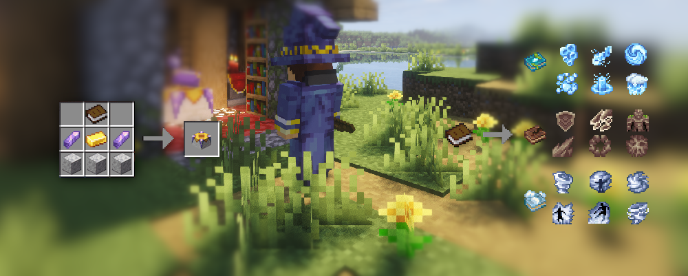
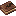
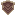
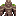
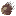
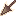

**How do you receive and cast the spells?**
* Spells from a Tome need the Tome equipped, and you need a weapon equipped that can cast spells (wands and staves).
* To get a Tome, find or craft a Spell Binding Table.
* Spell Scrolls exist for each element as well.
* Wands and staves come with one spell each. The Elemental Staff can hold a spell from any of the three elements.

**What does the Elemental Wizard do?**
* Uses water, earth and wind magic to damage, heal, control and protect.
* Each element has its own Tome: Water, Earth and Wind.
* Water: Balanced healing and damage. Weaknesses: low defense and mobility.
* Earth: Crowd control and protection. Weaknesses: limited mobility and range.
* Wind: Strong crowd control and damage on single targets. Weaknesses: low defense and no mobility.
* Equipment: Light armor

##  Tome of Water (Spell Book)

| Icon | Spell | ID | Description |
|---|---|---|---|
|  | Bubble Beam | `elemental_wizards_rpg:aqua_bubble_beam` | Channels a cone of bubbles that damages enemies and heals allies. |
|  | Waterballs | `elemental_wizards_rpg:aqua_waterball` | Shoots several water balls that damage enemies. |
|  | Springwater | `elemental_wizards_rpg:aqua_springwater` | Releases a burst of cleansing water that heals allies and damages enemies around you. |
|  | Hydro Beam | `elemental_wizards_rpg:aqua_hydro_beam` | Channels a beam of pressurized water that damages and soaks enemies in its path. |
|  | Healing Rain Cloud | `elemental_wizards_rpg:aqua_healing_rain` | Calls a rain cloud that damages enemies below it and heals allies. |
|  | Tidal Wave | `elemental_wizards_rpg:aqua_tidal_wave` | A wave that travels back and forth, damaging and knocking back targets. |

##  Tome of Earth (Spell Book)

| Icon | Spell | ID | Description |
|---|---|---|---|
|  | Stone Flesh | `elemental_wizards_rpg:terra_stone_flesh` | Encases you and nearby allies in stone armor, which raises armor and reduces the next hit taken at full health. |
|  | Impale | `elemental_wizards_rpg:terra_impale` | Pins a target with a sharp stone, blocking its movement and damaging it. |
|  | Terra Circle | `elemental_wizards_rpg:terra_drip_circle` | Creates a stone circle at the target's location that blocks enemies from passing and damages them. |
|  | Shattering Stone | `elemental_wizards_rpg:terra_shattering_stone` | Launches a stone that shatters on impact into fragments that damage and cause bleeding wounds. |
|  | Earthquake | `elemental_wizards_rpg:terra_earthquake` | A channeled quake that damages everything on the ground. It grows the longer you channel it. |
|  | Earth Golem | `elemental_wizards_rpg:terra_earth_golem` | Summons an Earth Golem that smashes the ground, throws stones and calls up damaging spikes that knock enemies up. |

##  Tome of Wind (Spell Book)

| Icon | Spell | ID | Description |
|---|---|---|---|
|  | Aeroblast | `elemental_wizards_rpg:wind_aeroblast` | A blast of concentrated air that launches enemies skyward and damages them. |
|  | Twister | `elemental_wizards_rpg:wind_twister` | A circling whirlwind that knocks back and damages the targets it hits. |
|  | Updraft | `elemental_wizards_rpg:wind_updraft` | Lifts enemies into the air, leaving them vulnerable while they are suspended. |
|  | Windfield | `elemental_wizards_rpg:wind_windfield` | Calls a field of strong wind that damages enemies and slows their movement. |
|  | Tornado | `elemental_wizards_rpg:wind_tornado` | Summons a tornado that pulls in and lifts enemies while damaging them. |
|  | Storm Draft | `elemental_wizards_rpg:wind_stormdraft` | Channels bursts of high pressure air that damage enemies and briefly stun them. |

## 🪄 Wand & Staff Spells

| Icon | Spell | ID | Found on | Description |
|---|---|---|---|---|
|  | Splash | `elemental_wizards_rpg:aqua_splash` | Aqua Wand | Releases a splash of water that heals allies and damages targets. |
|  | Water Whip | `elemental_wizards_rpg:aqua_water_whip` | Aqua Staff | Lashes out with a tendril of water that damages and soaks the target. |
|  | Stone Throw | `elemental_wizards_rpg:terra_stone_throw` | Terra Wand | Hurls a chunk of stone that damages enemies in a small area on impact. |
|  | Stone Spear | `elemental_wizards_rpg:terra_stone_spear` | Terra Staff | Launches a sharp stone spear that pierces enemies and causes bleeding wounds. |
|  | Gust | `elemental_wizards_rpg:wind_gust` | Wind Wand | Conjures a quick gust of wind that pushes enemies back and damages them. |
|  | Air Cutter | `elemental_wizards_rpg:wind_air_cutter` | Wind Staff | Slashes the air into wind blades that cut through enemies with strong knockback. |

## ⭐ Passive

| Icon | Spell | ID | Found on | Description |
|---|---|---|---|---|
| | Elemental Avatar | `elemental_wizards_rpg:elemental_avatar` | Avatar's Staff | On spell impact there is a chance to trigger an elemental passive, depending on your highest spell power element. |
