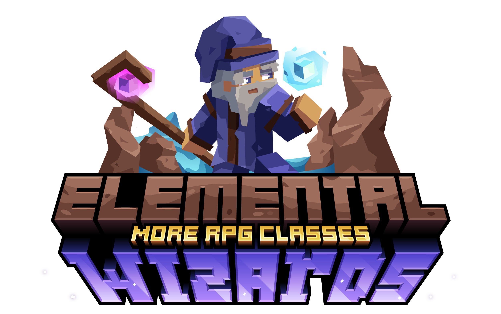
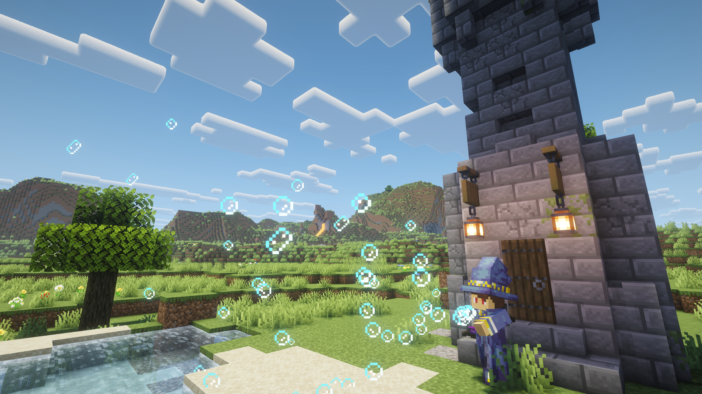
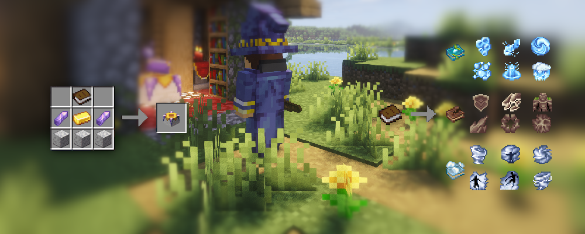
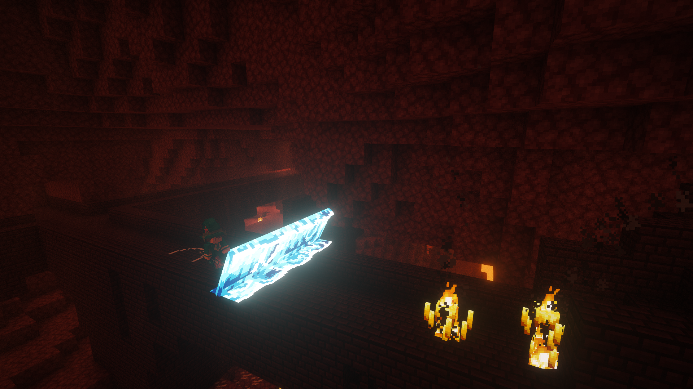
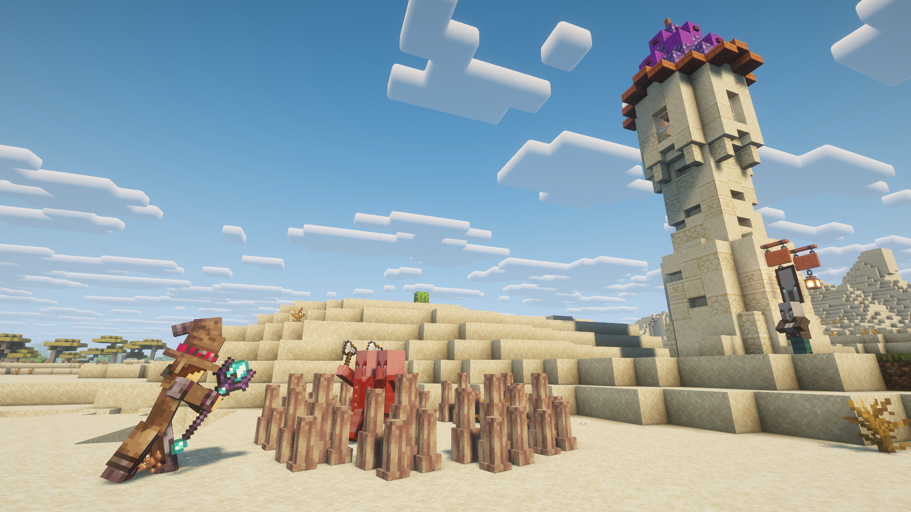
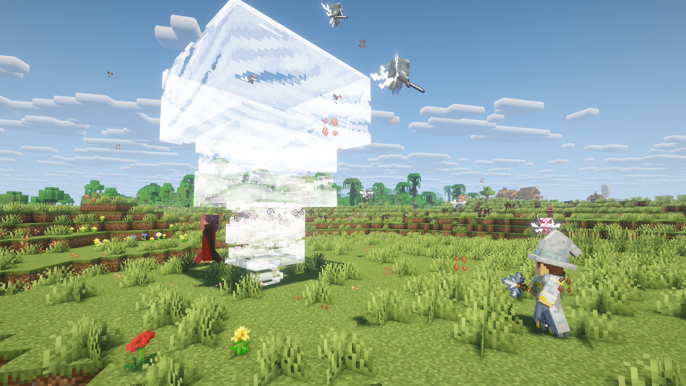
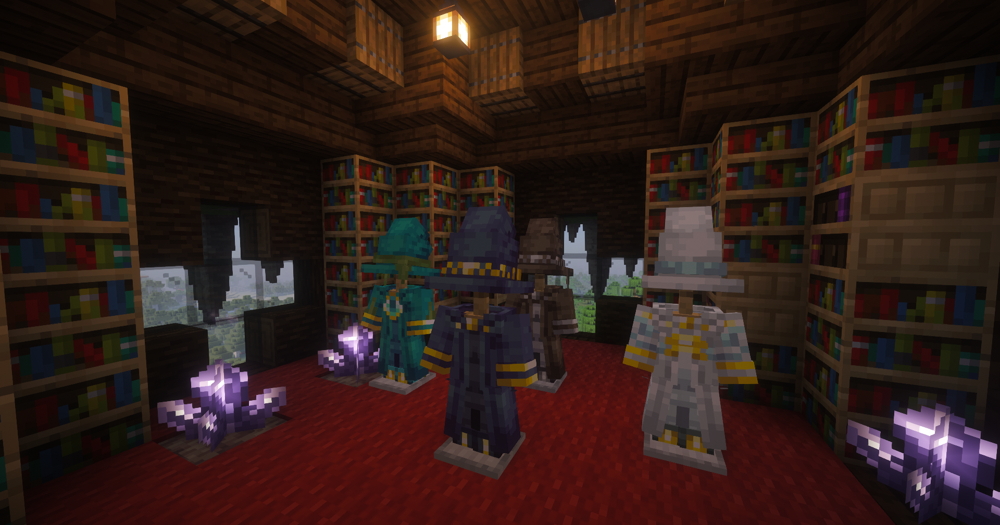

<h1>Master the elements to overcome your foes!</h1>
    

---

## 📂 Installation

### Required Mods

<table>
<thead><tr><th>Mod</th><th>Download</th></tr></thead>
<tbody>
<tr><td><b>Spell Engine</b></td><td> </td></tr>
<tr><td><b>Wizards</b></td><td> </td></tr>
<tr><td><b>More RPG Library</b></td><td> </td></tr>
<tr><td><b>Armor Model API</b></td><td> </td></tr>
<tr><td><b>Fabric API</b> (Fabric only)</td><td> </td></tr>
</tbody></table>

### Highly Recommended / Compatibility Mods

<b>Show recommended &amp; compatible mods</b>

<table>
<thead><tr><th>Mod</th><th>Compatibility Info</th><th>Download</th></tr></thead>
<tbody>
<tr><td><b>Better Combat</b></td><td>Wands and staves are set up as Better Combat weapon types</td><td> </td></tr>
<tr><td><b>Armory (RPG Series)</b></td><td>Ocean, Hurricane and Mountain robe sets</td><td> </td></tr>
<tr><td><b>Arsenal (RPG Series)</b></td><td>The Avatar's Staff, a tier 5 staff that gets the Elemental Avatar passive</td><td> </td></tr>
<tr><td><b>BetterEnd</b></td><td>Crystal Aqua Staff and Aeternium Wind Staff, repairable with Aeternium Ingots</td><td> </td></tr>
<tr><td><b>BetterNether</b></td><td>Ruby Terra Staff, repairable with Nether Rubies</td><td> </td></tr>
<tr><td><b>The Aether</b></td><td>Valkyrie Elementalist Staff, which can use spells from all three elements and is repairable with Ambrosium Shards</td><td> </td></tr>
<tr><td><b>LNE Wizards</b> (Loot &amp; Explore add-on)</td><td>Elemental Evokers, Magic Orbs and element staffs for Loot &amp; Explore</td><td></td></tr>
</tbody></table>

If one of these is missing, the matching items simply won't show up. The mod loads fine without them.

---

## 🕹️ Features

The Elemental Wizard is a spell caster who works with water, earth and wind. Each element has its own Tome with six spells, and the Avatar's Staff combines all three.

### Spells

Each element has its own spell book, the Tome of Water, the Tome of Earth and the Tome of Wind. Equip a Tome and hold a weapon that can cast spells to use its spells.

To get one, find a Spell Binding Table or craft your own and surround it with bookshelves.

**Tome of Water**: Healing and water damage, with the Healing Rain Cloud and Tidal Wave.

**Tome of Earth**: Crowd control and protection, with Stone Flesh, Impale and the Earth Golem.

**Tome of Wind**: Strong crowd control and damage on single targets, with Updraft, Tornado and Storm Draft.

For the full spell list with IDs and descriptions, check the [Wiki](https://github.com/ProfessorFichte/Elemental-Wizards/wiki/%E2%9C%A8Spells).

### Combat & Equipment

- Wands and staves for each element, with netherite versions
- A robe set for each element, with netherite versions
- The Elemental Staff, which can hold a spell from any of the three elements

---

## ⚙️ Configuration

<b>Show config files</b>

<table>
<thead><tr><th>Setting</th><th>File</th></tr></thead>
<tbody>
<tr><td>Weapon &amp; armor values</td><td><code>config/elemental_wizards_rpg/equipment_v1.json</code></td></tr>
<tr><td>Status effects</td><td><code>config/elemental_wizards_rpg/effects_v2.json</code></td></tr>
<tr><td>Tweaks (e.g. ignore required mods for weapons)</td><td><code>config/elemental_wizards_rpg/tweaks.json</code></td></tr>
<tr><td>Summoned entities (Earth Golem)</td><td><code>config/elemental_wizards_rpg/summoned_entities.json</code></td></tr>
</tbody></table>

---

## 🎥 Showcases

<b>Show video</b>

<!-- SHOWCASE: YouTube-Video hier einfügen (Format wie bei Bard) -->

Thanks to all content creators for showcasing my mod

---

## 🙌 Credits

<b>Show credits</b>

<table>
<thead><tr><th>Who</th><th>Contribution</th></tr></thead>
<tbody>
<tr><td>Daedelus</td><td>Created the Spell Engine API</td></tr>
<tr><td><a href="https://slepykat.carrd.co/">Slepykat</a></td><td>Created the projectile, effect, entity and armor models</td></tr>
<tr><td><a href="https://sirghaith.artstation.com/">SirGhaith</a></td><td>Created the Spell Book texture</td></tr>
<tr><td>Ch1sho</td><td>Created the Ukrainian translation</td></tr>
<tr><td>Anpan715</td><td>Created the Japanese translation</td></tr>
</tbody></table>

---

<h3>Check out my other RPG-themed mods!</h3>
<!-- BANNERS:own -->
<table>
<tbody>
<tr><td align="center" style="text-align:center"></td><td align="center" style="text-align:center"></td><td align="center" style="text-align:center"></td></tr>
<tr><td align="center" style="text-align:center"></td><td align="center" style="text-align:center"></td><td align="center" style="text-align:center"></td></tr>
<tr><td align="center" style="text-align:center"></td></tr>
</tbody>
</table>
<!-- /BANNERS:own -->

<h3>Discover more of the RPG Series by Daedelus</h3>
<!-- BANNERS:series -->
<table>
<tbody>
<tr><td align="center" style="text-align:center"></td><td align="center" style="text-align:center"></td><td align="center" style="text-align:center"></td></tr>
<tr><td align="center" style="text-align:center"></td><td align="center" style="text-align:center"></td><td align="center" style="text-align:center"></td></tr>
<tr><td align="center" style="text-align:center"></td><td align="center" style="text-align:center"></td><td align="center" style="text-align:center"></td></tr>
</tbody>
</table>
<!-- /BANNERS:series -->

<h3>More RPG content by other Spell Engine devs</h3>
<!-- BANNERS:others -->
<table>
<tbody>
<tr><td align="center" style="text-align:center"></td><td align="center" style="text-align:center"></td><td align="center" style="text-align:center"></td></tr>
</tbody>
</table>
<!-- /BANNERS:others -->

---

Questions, bugs or ideas? Join the <a href="https://discord.com/invite/AShKd5XrTu">Discord</a> or open an issue on <a href="https://github.com/ProfessorFichte/Elemental-Wizards/issues">GitHub</a>.

